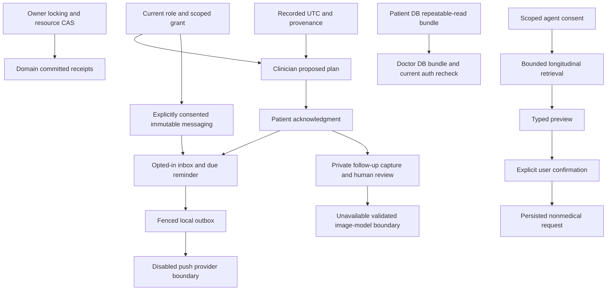

# Expanded backend program — source-grounded master ledger

2026-10-15 Cairo. Baseline canonical main0702773f664825b90b57c4dda53193f5672d23e0;
isolated checkout created for this chat. User authorization explicitly supersedes
the old documentary H5 sequencing gate. Nothing here authorizes deployment or
represents mobile/live-provider/clinical certification. Overall program PARTIAL.
OPEN is unfinished source work, not an external blocker and not removed scope.

| Track | Delivered source / acceptance evidence | Exact residual |
|---|---|---|
| A H5 messaging | Explicit patient enrollment per original grant; persisted immutable thread/messages; thread and sequence pagination; frozen message page high watermark; monotone read watermark; owner/actor/payload/key-bound committed send/readback; privacy-safe audit; role/current original grant/expiry/revoke/withdraw checks on reads/replays; erase either participant; concurrent same/different send, lost response and actual revoke/lock-wait tests | No edits/per-message deletes by conservative clinical-history design. Account-lifetime retention follows erasure policy; no legal retention certification, emergency SLA or real doctor verification invented |
| A H5 follow-up | Typed real plan separate from free-text notes; doctor creation/reschedule/review, patient visibility/ack/withdrawal, CAS and committed receipts, routine/experiment/observation and private capture linkage, explicit local wall time/IANA/fold with fixed UTC, cancellation/reminder invalidation | Local source implemented; clinician scheduling/retention policy is not a clinical release approval |
| B H6 | Default-off typed preferences/CAS, session/credential/expiry-bound encrypted device registration and revoke/account switch, due inbox/read/unread flags and app-read receipts, atomic message and acknowledged-plan enqueue, retry/backoff/dedup/quiet-hours/source cancellation, PG SKIP LOCKED/lease token/expired-worker fencing, local fake and disabled-provider tests | OPEN recurring routine reminder enqueue generation; hosted scheduler/worker activation absent. Inbox is a currently authorized projection, not a complete cancelled/deleted-event history. No automatic TTL purge. BLOCKED actual push until genuine configured provider, idempotency/privacy validation and real device evidence; never sent/delivered fabricated |
| C H7 | Clinician/source-linked comparison plans, explicit owned persisted baseline, patient consent, revision/reschedule/cancel receipts, private new follow-up capture, immutable lifecycle/evidence event snapshots, human review and revision-axis history contract; no routine-end auto-schedule | BLOCKED actual image inference/AI-proposed dates until integrated validated model and clinical approval. Null numerical results/accuracy; no clinical image chart or reconstructed full historical source model. Tests use synthetic contracts, not accuracy evidence |
| D H8 | Durable owner/JWT-bound scoped sessions and raw untrusted turns, redacted provenance/freshness retrieval, bounded evidence digest, 5-minute stale checks, budgets8 calls/40 turns/5 active sessions, typed dry-run preview, explicit confirmation/CAS/duplicate-safe request recording, privacy audit/revoke/account erasure, urgent escalation, disabled model metadata | Confirmed requests are requests only: no routine/medication/clinical plan mutation, no notification/clinician routing. OPEN clinician-consented request inbox/action dispatch, wider memory lifecycle/TTL purge and approved tool integrations. BLOCKED real agent model until genuine adapter/clinical/provider validation. Existing /chat/PSM remain distinct and not autonomous |
| E product receipts | CREATE retained; PATCH/DELETE added with original payload/preconditions/revision/result, SQL atomic audit/side effects, 30-day replay/readback, owner isolation, erased snapshots, signed-journal restore scrubbing and durable delete tombstone. PG same-key PATCH/DELETE and protected migration tests | No durable rejected/in-flight reservation/fencing registry or exact-once independent journal/SQL claim |
| E routine/experiment receipts | Explicit receipt integration for routine create/update/stop; experiment create/edit/activate/finish/cancel/evaluate/legacy pause, original typed results, original If-Match and Routine-If-Match binding, evaluation identity, side-effect atomicity, product/account/restore erasure | Legacy clinical note/review, grant/consent/onboarding attempts remain OPEN. Existing check-in/capture/adherence receipts retain their bounded committed/unknown/expired subsets |
| E evidence/history/calendar | Stable immutable message sequence pages and plan revision events; existing adherence cursors and frozen evidence retained. PostgreSQL application/migration connections explicitly UTC; plan time provenance and quiet-hour DST policies tested. Patient and now doctor DB-only RR bundles share one Safety/clock and separately recheck current authority | OPEN full future routine configuration event stream/all-writer history, all-domain stable as-of histories, historical reconstruction and prospective user local-day/travel cutover. No external or cross-endpoint atomicity or historical replay token |
| F regression/contracts | Small normal main pushes after each full suite, actual disposable PG migrations/locking/races, SQLite seeded migration, compile/OpenAPI/diff/secrets checks, complete separate Amr handoff and registered request/response contracts | No configured Python linter found. No Flutter/Tester/native edits, simulator/device run, Azure/live DB migration, staging/production deployment, managed DR/performance/TLS certification |

## Conservative calendar decisions selected now

1. Existing check-in/adherence/reporting dates remain UTC. No UTC history is relabeled
   as a local date; existing uniqueness and source provenance remain authoritative.
2. New clinical due instants freeze submitted IANA zone/local wall time/explicit
   overlap fold and resolved UTC. Nonexistent times and unspecified overlaps reject.
   Travel does not reinterpret an existing due instant; explicit reschedule resets
   patient acknowledgment. Notification quiet hours alone use the current preference
   zone, including both repeated hours; equal endpoints disable quiet hours.
3. A future prospective per-account calendar v2 could freeze an effective-from
   date/zone and explicit travel cutover events, with overlap/gap and uniqueness
   tests. This is OPEN source work. Reinterpreting old UTC days from the current
   device zone is rejected as a non-conservative option. No current decision is
   deferred to make these safe defaults operational.

## Implementation-ready remaining source work, without routine approval gates

| Priority | Work | Required transaction/acceptance boundary |
|---|---|---|
| 1 | Legacy notes/reviews attempts in api/v1/doctor.py and services/doctor_loop.py | Bind doctor/patient/original grant/op/key/typed payload; original immutable result in same SQL commit; reauthorize original grant on every lookup; preserve private-current precedence/Safety; scrub doctor and patient deletion/restore; real PG concurrent/revoke/lost-response cases |
| 2 | Selected/bulk grant generation/revoke and policy/onboarding attempts | Preserve H1 single-use QR claim and explicit EXPORT evidence; never replay a consumed/revoked bearer invitation as current authority. Bind patient actor/original session/payload; minimized consumed/expired/revoked readback; current-role/session/consent checks and atomic audit |
| 3 | Full routine configuration events | Capture future create/edit/stop plus product archive and experiment intervention writers in the same transaction, including revision, actor, full frozen configuration and reason/source. No historical backfill guess; owner-scoped stable cursors and erasure; PG CAS/rollback proofs |
| 4 | Recurring routine reminders | Explicit opted-in wall-time configuration, slot/entry revision and per-occurrence identity, prospective calendar/travel/DST policy, bounded enqueue horizon/worker, cancel on changes/logout/erase, negative and real PG duplicate claims; no automatic comparison scheduling |
| 5 | Notification and agent history/lifecycle | Authorized cancellation/history views, source/privacy-safe operation readbacks and TTL cleanup; consented doctor routing for user-confirmed requests; supported failure/unsupported states must remain explicit |
| 6 | Longitudinal historical views/local calendar | Immutable all-domain event sources, stable bounded cursors/as-of policies, declared missing history, explicit prospective zone cutover; do not claim reconstruction from mutable current rows |
| 7 | Genuine external adapters | Actual push provider/device evidence; validated comparison model/model version/input-output governance; real constrained agent adapter and tool-output validation. External blockers are not fulfilled by fake/local fixtures |

No feature is silently marked deferred or complete. These OPEN rows are outstanding
implementation, not requests for new routine permission. Source contracts:
MESSAGING_CONTRACT.md, NOTIFICATION_CONTRACT.md, CLINICAL_PLAN_CONTRACT.md,
AGENT_PLATFORM_CONTRACT.md, PRODUCT_MUTATION_ATTEMPTS.md,
CONFIGURATION_ATTEMPTS.md and DOCTOR_CLINICAL_SNAPSHOT.md.

## Verification ledger

Earlier green full milestones:963,979,996,1011,1027 and1054 passed, all with zero
failures/skips.1054 includes66 actual PG cases; evidence/foundation-final.json is
under evidence/expanded-20261015. An intermediate product receipt run had7 failures
in photo/account-only journal mock paths; its evidence is retained. The repair
correctly avoids inspecting product receipt domains when no signed product intent
exists;93 focused cases and the subsequent1054 full cases passed. No tests were
disabled, weakened or skips introduced to hide that failure.

Latest configuration increment:1070 passed,72 real PG cases,zero failures/skips,
216 dependency deprecation warnings. Exact PG cases and exit status are recorded in
evidence/expanded-20261015/configuration-final.json. Seeded SQLite/PG JSON proves
20261008_01→20261015_09 preserves16 old tables/8 rows, legacy export restriction and
old check-in reconciliation; Alembic check finds no new upgrade operations. Compile,
OpenAPI generation and diff checks pass; no configured Python linter. Migration
order is04 messaging →05 notifications →06 clinical plans →07 agent →08 product
mutations →09 configuration attempts, after existing03. Populated downgrades refuse
data loss. Only disposable synthetic databases were migrated.

The new chat-owned PG cluster was stopped after validation and its directory
retained. Prior preserved cluster directories and unrelated local clones were not
modified. No provider calls, privileged machine changes or deployment were used.

Code push ledger (normal push and remote SHA verified after each):

| Scope | Commit |
|---|---|
| DAG and explicit wall-time policy | 1c61bc6630cf9feb249658ebf9573b66090ed9e4 |
| Consented immutable messaging | 9fee88c2bd0eca289b8a226b1141cf5800ccec54 |
| Local notification inbox/outbox | f578aa553766d0fc3f5e2852cf93bb79ee13391b |
| Clinical follow-up/comparison plans | bd29cb57101ff0a1646eb299f4ee2d65f3c8272c |
| Durable local agent/request broker | 5c4599cfc8923d7bda1784a7510c5fa3586f23da |
| Product mutation receipts/doctor MVCC bundle | 4f06d4d9065c42adb1a3e5b9ff4be992a852550d |
| Routine/experiment operation receipts | 3ac5358295e7213c344a259911f7f2ae4c8a4a03 |

Final docs commit and clean final remote comparison are recorded in the external
Arabic report to avoid a self-referential SHA. Amr contract: EXPANDED_FLUTTER_HANDOFF.md.
