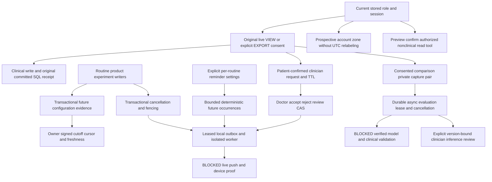

# Expanded backend master status — post-expanded completion wave

> 2026-10-24 F7 update: source milestone `7e7cd166b972af28eb60eeaf3b2c79b6ed91dbc2`
> adds explicit original-grant clinical writes, Agent discovery/request paging,
> authorized notification targets plus state CAS, and evaluation-cancellation
> receipts. Migration head is `20261024_14`. See `BACKEND_F7_FINAL_REPORT_AR.md`.
> F7 real PostgreSQL validation is BLOCKED; historical PostgreSQL results below
> remain historical and must not be interpreted as F7 proof.

Canonical baseline independently verified and fetched:
`275e753b3d07cbe86f0aed08d558802355ce2c6d`. Work uses a new isolated clone. M0
acceptance/DAG commit `91e659d15a2d95c07f89a5adac06459124c08051` was normally pushed
and its remote SHA verified. Final implementation verification is recorded below.
Overall full Dermaire vision remains PARTIAL.

DONE below means the stated source contract is implemented and locally verified;
it never means mobile integration, production deployment or clinical certification.
OPEN is actual remaining implementation, not a feature silently removed/postponed.
BLOCKED requires missing external evidence. User authorization supersedes former
sequencing gates, never privacy/consent/clinical or no-live-resource boundaries.

## Dependency DAG

## Current source ledger

| Feature | Status | Implemented boundary | Exact remaining |
|---|---|---|---|
| H1 doctor provision and VIEW/EXPORT | DONE bounded source | Existing provisioned role, original grant, explicit EXPORT selected doctor, one-use QR, revoke/expiry/session checks retained | Real license/clinical governance is not inferred from stored role |
| M1 clinical notes/reviews | DONE committed subset / PARTIAL full attempts | Atomic actor/patient/grant/payload/key-bound original receipts, 30-day replay/readback, review CAS/private-current, bilateral erasure | No durable rejected/in-flight/fenced reservation registry; missing receipt is unknown |
| M1 grant consent receipts | DONE committed subset | Issue, claim, single revoke, bulk revoke; original consent/session binding; no claimed/revoked/expired invitation resurrection | Keys remain optional for legacy clients; universal mandatory-key migration OPEN |
| Safety/profile onboarding | DONE existing version/current completion readback / PARTIAL future versions | Exact safety policy equality, atomic first acceptance/profile timestamp+audit, owner/version receipt readback; legacy audit absence unknown | New onboarding-version transitions and full attempt registry OPEN |
| H2-H4 foundation | DONE bounded prior contracts | Product/check-in/capture/adherence/config receipts and signed deletion/restore; recorded UTC and private evidence rules retained | All-domain immutable historical reconstruction and universal attempt statuses OPEN |
| H5 messaging/followups | DONE bounded prior source | Independently consented immutable messages/read pages; clinician plan scheduling/ack/capture/review; original grant privacy and erasure | No emergency SLA, license or clinical release certification |
| Patient/doctor snapshots | DONE DB-only prior contract | Real PG RR snapshot, one clock/Safety and current final authority recheck, private-current precedence | No cross-endpoint/external provider atomicity or historical replay token |
| M2 routine configuration evidence | DONE prospective ORM subset | All current create/edit/stop/archive/experiment writers; full frozen config/product evidence, known actor/writer provenance, atomic rollback and reminder cancellation | No guessed historical backfill; direct maintenance SQL requires its own explicit evidence process |
| M2 history/freshness | DONE bounded source | Owner/filter signed expiring cursor, timestamp cutoff, coverage/freshness labels and erasure | Cutoff is not MVCC; historical all-domain reconstruction remains OPEN |
| M2 local calendar | DONE prospective display/scheduling policy / PARTIAL full local-day adherence | Immutable account IANA revisions at server effective instant; travel/DST/midnight labels; reminders separately approved; legacy UTC keys never relabeled | Separate versioned local-day adherence namespace/migration OPEN; current adherence remains explicitly UTC |
| M3 recurring reminders | DONE bounded local source | Explicit AM/PM/BOTH entry schedule, IANA wall minute/fold/gap-skip, stable revision/day/slot identities, bounded generation/no missed backfill, actual PG duplicate/CAS/delete races | No hosted generation scheduler or real delivery evidence |
| H6 inbox/outbox | DONE prospective local attempt history / PARTIAL provider proof | Read/unread, privacy-filtered cancellation/current state, durable per-lease start/retry/unknown/provider-accepted attempts, session logout fence, source/consent/setting cancellation, worker retry/leases/quiet hours | Pre-migration history is unavailable; genuine provider transport/delivery proof remains BLOCKED |
| H6 provider operations | BLOCKED live | Executable explicitly isolated default-disabled worker; generic no-PHI push payload; accepted is not delivered | Genuine transport/configuration, idempotency/privacy/timeout review, hosted operations, real device/proof |
| M4 clinician request lifecycle | DONE bounded local source | Explicit separate routing consent, doctor inbox/accept/reject/review CAS, original grant+session+TTL, committed opt-in notices, withdrawal/expiry/bilateral erase | Inbox pagination beyond 100 and broader approved tools OPEN |
| M4 action broker | DONE allowed nonclinical subset | Actual mark_notification_read with typed preview/explicit confirmation/current source/unread CAS/atomic receipt; other clinical actions stay proposals only | No autonomous clinical execution; broader integrations require their own explicit allowlist contracts |
| M4 model inference | BLOCKED live | Strict versioned envelopes/config descriptor; disabled/unsupported provider says unavailable, raw turns never invoke tools | Genuine constrained model transport/credentials/governance and clinical/provider validation |
| M5 comparison jobs | DONE bounded infrastructure | Plan-linked private capture pair + fresh processing consent, durable event queue/leases/retry/cancel/revocation fence, original receipts and explicit artifact/job-bound human review | Real artifact loading/verification and secure image transport absent |
| M5 clinical image inference | BLOCKED | No verified artifact found; default unavailable; synthetic output restricted to nonclinical image-quality flags | Model training/validated artifact, clinical validation and numerical/diagnostic result governance; no accuracy/improvement claim |
| M6 regression/handoff | DONE isolated source gate | Fresh chat-owned PG, legacy SQLite, seeded migrations/drift, full suite, compile/OpenAPI/diff/security review and Amr handoff | No live resource/device/provider/clinical certification |

## Calendar, privacy and operation reconciliation

Existing UTC adherence uniqueness/snapshots remain authoritative. Calendar changes
are forward-only recorded events, never client backdated. Account display travel
may change local_today, without changing old reports or saved clinician instants.
Reminder settings freeze their own explicit zone/fold; gaps skip, overlaps occur
once. Setting edits create a new effective revision and cancel old occurrences.
Current routine edits/stop/archive transactionally fence jobs. Consent removal
disables schedules; re-enabling preferences never resurrects them. Logout cancels
that session's pending push jobs and clears its device credential. Account deletion
purges all new owned/clinical/directed content; signed recovery uses that purge.

A committed receipt proves the domain SQL transaction, not external transport.
Rejected/in-flight/unknown are never fabricated. Retain original key/body/CAS after
uncertainty; do not issue a replacement key as if unknown proved nonexecution.
Original historical receipt is not current resource state. Clinical role, consent,
Safety and private-current precedence remain authoritative over receipt replay.

## Validation and operations ledger

M0 plan/docs only verified and normally pushed. Implementation focused gates include
clinical receipts/PG races, prospective history/calendar/CAS rollback, reminder
DST/dedup/deletion/CAS, agent request/tool/TTL/notification privacy and comparison
queue/lease/revocation/human review with clearly synthetic adapters.

An initial combined run had 109 passed and one setup error from Windows default
pytest temporary-directory permissions; using a new chat-owned basetemp fixed it,
without host privilege changes or touching old clusters. A rehearsal invocation
without ENVIRONMENT=test was correctly refused; re-running with the required test
environment passed 21 cases including seeded SQLite/PG migrations and reminders.
The first full run is retained: 1129 passed and 2 compatibility failures exposed by
the new history/revoke changes. Both were repaired without weakening/skipping tests.
The final complete run passed 1137 tests, including 90 tests marked by the gate as
using an actual fresh isolated PostgreSQL database, with 0 failures, 0 errors and 0
skips in 346.31 seconds. There were 217 dependency deprecation warnings. Seeded
SQLite and PostgreSQL migrations through 13 and Alembic drift check passed. Python
compileall, OpenAPI generation (114 paths/117 schemas), git diff --check and the
privacy/concurrency review passed. Evidence is retained outside Git under this
chat's `work/evidence-final` directory.

New migration order: 09 -> 10 -> 11 -> 13. No 12 revision. Readiness expects 13. All new
SQL resources are local synthetic only. No Flutter/Tester/native edits, devices,
provider calls, billable actions, Azure/live DB/staging/production deployment,
host privilege changes or preserved-cluster deletion occurred.

Current Amr contract: EXPANDED_FLUTTER_HANDOFF.md. Domain details:
CLINICAL_CONSENT_ATTEMPTS.md, PROSPECTIVE_HISTORY_CALENDAR_HANDOFF.md,
RECURRING_REMINDER_WORKER_HANDOFF.md, WAVE_AGENT_COMPARISON_HANDOFF.md.
M0 exhaustive acceptance baseline: COMPLETION_WAVE_EXECUTION.md.

Normal push ledger, remote SHA checked after each push:

| Scope | Commit |
|---|---|
| M0 source-grounded DAG and exhaustive acceptance baseline | `91e659d15a2d95c07f89a5adac06459124c08051` |
| M1–M5 receipts/history/calendar/reminders/agent/comparison source and tests | `9a8a324b8e90d8972b8ce58db99fd2d2261933fa` |
