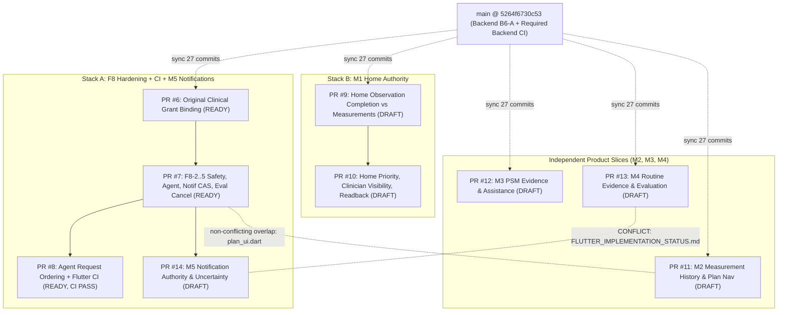

# DERMAIRE — Cross-PR Architecture Review, Dependencies & Consolidation Plan (`DERMAIRE-FLUTTER-AUDIT-001`)

- **Audited `main` HEAD SHA:** `5264f6730c53b7a74833f90c4aa9ec7252f97909`
- **Common Flutter PR Merge-Base:** `b995873f2b76e0c37a08f23fbf40322174aba6fe` (27 commits behind `main`)
- **Audit Date:** 2026-11-22

---

## 1. Cross-PR Architecture Review (All 9 Flutter PRs Together)

### 1.1 Shared Files Modified by Multiple PRs (`HIGH` confidence — verified via GitHub API & `git`)

| File Path | PRs Modifying It | Relationship | Merge Risk |
|---|---|---|---|
| `app/docs/FLUTTER_IMPLEMENTATION_STATUS.md` | `#9`, `#10`, `#13`, `#14` | `#10` stacked on `#9`; `#13` and `#14` independent | **HIGH (Direct content conflict proven between `#13` and `#14` via `git merge-tree`)** |
| `app/lib/plans/plan_ui.dart` | `#7`, `#11` | Independent branches | **LOW–MEDIUM** (`git merge-tree` clean: `#7` edits `_EvaluationActionsState` L878–892, `#11` edits imports + `_ClinicalPlanState` L280–325; verify combined widget tests) |
| `app/lib/services/api_service.dart` | `#6`, `#7` | Stacked (`#6 -> #7`) | **NONE** (strict linear ancestry) |
| `app/lib/agent/server_agent_controller.dart` | `#7`, `#8` | Stacked (`#7 -> #8`) | **NONE** (strict linear ancestry) |
| `app/lib/agent/server_agent_models.dart` | `#7`, `#8` | Stacked (`#7 -> #8`) | **NONE** (strict linear ancestry) |
| `app/lib/notifications/inbox_controller.dart` | `#7`, `#14` | Stacked (`#7 -> #14`) | **NONE** (strict linear ancestry) |
| `app/lib/notifications/inbox_models.dart` | `#7`, `#14` | Stacked (`#7 -> #14`) | **NONE** (strict linear ancestry) |
| `app/lib/notifications/inbox_ui.dart` | `#7`, `#14` | Stacked (`#7 -> #14`) | **NONE** (strict linear ancestry) |
| `app/lib/home/home_response.dart` | `#9`, `#10` | Stacked (`#9 -> #10`) | **NONE** (strict linear ancestry) |
| `app/lib/home/patient_home.dart` | `#9`, `#10` | Stacked (`#9 -> #10`) | **NONE** (strict linear ancestry) |
| `app/lib/home_controller.dart` | `#9`, `#10` | Stacked (`#9 -> #10`) | **NONE** (strict linear ancestry) |
| `app/test/home_state_integration_test.dart` | `#9`, `#10` | Stacked (`#9 -> #10`) | **NONE** (strict linear ancestry) |

### 1.2 Pairwise `git merge-tree --write-tree` Verification Matrix (`HIGH` confidence)
All 9 PRs were tested in-memory against `origin/main` and against each other without modifying any branch:
- **Every PR (`#6`–`#14`) merges cleanly against `origin/main`** (zero conflicts with Backend PRs #1–#4, #16, #20–#22).
- **Only 1 pairwise conflict exists across the entire 9-PR set:** `PR #13` × `PR #14` on `app/docs/FLUTTER_IMPLEMENTATION_STATUS.md`.
- **Zero Dart code conflicts** exist across any non-stacked pair (only non-conflicting hunk overlap in `app/lib/plans/plan_ui.dart` between `#7` and `#11`).

### 1.3 Ten-Dimension Architectural Review

1. **Overlapping State Management & Navigation:**
   - All PRs preserve the singleton `ApiService.instance` + `DermaireState` + scoped `PrivateController` pattern (`app/lib/integration/private_view.dart`) with `sessionGeneration` fencing.
   - `AppShell` (`app/lib/app_shell.dart`) is not modified by any of the 9 PRs; navigation additions are localized inside `PatientHome` (`#9`/`#10`), `ClinicalPlanScreen` (`#11`), `PsmScreen` (`#12`), and `InboxScreen` (`#7`/`#14`). No routing collisions exist.
2. **Authentication & Token Handling:**
   - Sessions are **strictly memory-only** (`_authToken` in `ApiService`, `app/lib/services/api_service.dart:1140-1143`, `1309-1329`). Legacy `SharedPreferences` keys are proactively wiped on `init()` and `_clearSession()`.
   - There is **no token refresh mechanism** on Flutter or Backend (JWT TTL is 24h via `ACCESS_TOKEN_EXPIRE_MINUTES=1440`; expiry timer clears session and forces re-login via `DermaireApp._sessionEnded` in `app/lib/main.dart:23-39`).
   - PR `#7` hardens password reset to match Backend B4/B5 (8-digit code, 8–128 chars, whitespace preserved, no debug token echo).
3. **Patient–Doctor Relationship & Consent Authority:**
   - PR `#6` closes the original-grant-binding gap on clinician note/review writes (`Original-Grant-Id` + `Original-Grant-Binding: explicit`).
   - PR `#7` adds server-verified safety policy contract fetching (`GET /api/v1/auth/safety-policy` + SHA-256 verification), safely gated behind `DERMAIRE_VERIFIED_POLICY=false` until the approved HTTPS policy document is published.
   - PR `#10` surfaces urgent clinician warnings and recorded-note access on Home without bypassing consent checks.
4. **Image Upload & Privacy Boundaries:**
   - Images are never accessed via public/SAS URLs; all image reads go through authenticated Backend proxy endpoints (`GET /api/v1/captures/{id}/image`, `GET /api/v1/checkins/{id}/image`).
   - PR `#11` enforces background privacy hiding for measurements, strict capture-ID/fingerprint/session binding, and forbids account-wide measurement history from implicitly attaching evidence to a clinical plan.
   - PR `#12` and `#13` enforce background read-epoch invalidation so stale private views never survive app backgrounding or session switches.
5. **Notifications & Operation-Status Uncertainty:**
   - PR `#7` introduces `expected_revision` CAS on read/unread and `412` refresh without replay.
   - PR `#14` extends this to retain exact original CAS intents in session memory for preferences/read/withdrawal, isolating `/notifications/history` transport failures from the current authorized inbox.
   - **Architectural Note:** As documented in PR `#14`, Backend currently lacks durable attempt-receipt endpoints for notification preferences/reminders; original-attempt uncertainty is bounded to session memory until a Backend attempt-receipt contract is added.
6. **Measurements, Observations, Routine Adherence & Evidence History:**
   - PR `#9`/`#10` cleanly separate `observation_status` (report-only or report+measurement) from `today_checked_in` (confirmed measurements).
   - PR `#11` distinguishes `404` (not measured) and `409` (rejected capture) from numeric `0`.
   - PR `#13` enforces experiment metric schema v1 (`score_0_to_100` / `score_points`), zero-vs-missing distinction, and unknown-vs-skipped adherence.
7. **Offline Behavior, Retries, Timeouts & Duplicate Requests:**
   - No PR introduces automatic POST/PUT/DELETE replay. Write operations use explicit `Idempotency-Key` or `expected_revision` CAS, and uncertain outcomes are quarantined (`_quarantinedOperations` in `api_service.dart:335-388`) until read-only reconciliation confirms server state.
   - All HTTP calls have bounded timeouts (10s–60s). Offline behavior is fail-closed with explicit error states; there is no offline write queue (intentional for clinical safety).
8. **Server-Authoritative vs Client-Derived State:**
   - Consistently server-authoritative across all 9 PRs. No client-side counters, synthetic deltas, or local clinical clearances are introduced.
   - **Remaining Coordination Gap (PR #13):** Backend `experiments.py` currently uses a fixed 28-day baseline lookback on activation; per-case baseline window authority requires a future coordinated Backend+Flutter contract.
9. **Error Messages, Loading States & Accessibility:**
   - Consistent fail-closed error banners, busy guards preventing double-submission, and semantic labels. PR `#9` fixes a reduced-motion `AnimatedSize` layout exception on Home.
10. **Arabic RTL Support:**
    - **Verified Product Decision (`HIGH` confidence):** Per `app/README.md:5-8` and `app/lib/main.dart:77-79` (`locale: const Locale('en')`, `supportedLocales: const [Locale('en')]`), **Dermaire Flutter is intentionally English-only**, including on Arabic-configured devices. Custom RTL layout and Arabic localization are explicitly **not** product requirements.

### 1.4 CI & Branch Protection Inconsistency (`HIGH` confidence)
- `main` currently enforces Backend CI workflows (`.github/workflows/backend-ci.yml`, `backend-b3-ci.yml`, `backend-b4-b5-ci.yml`) on **every pull request** with no path filter, and those workflows check out `pull_request.head.sha` and assert Backend OpenAPI == `(116, 119)`.
- Because all 9 Flutter PRs are 27 commits behind `main`, **every one of them will fail Backend CI until rebased/merged with `main`**.
- Conversely, `main` has **no Flutter CI workflow** until PR `#8` (`.github/workflows/flutter-f8.yml`) is merged. Note that `flutter-f8.yml` uses `paths: ['app/**', '.github/workflows/flutter-f8.yml']`; if Flutter CI is later added as a required GitHub ruleset check on `main`, the `paths` filter must be removed (or paired with a path-agnostic gate job) so Backend-only/docs-only PRs are not stuck waiting for a skipped check.

---

## 2. Dependency Graph & Consolidation Topology

---

## Deliverable C — Consolidation Plan (Exact Recommended Order)

**Do not merge any PR during this audit.** Execute the following sequence only after Hussam's review and authorization.

### Step 1 — PR #6 (`flutter(f8): enforce original clinical grant binding`)
- **Prerequisites:** Sync branch with `main` (`5264f6730c53+`).
- **Required Fixes:** Rebase/merge `main` so Backend CI passes; obtain required peer review.
- **Required Tests:** `flutter analyze --no-pub`, `flutter test --no-pub test/wave_f8_original_grant_test.dart test/wave_q_clinical_receipt_test.dart`, full `flutter test`, plus required Backend CI on GitHub.
- **Expected Impact on `main`:** Enforces `Original-Grant-Id` / `Original-Grant-Binding: explicit` on clinician note/review writes (matches Backend `main`).
- **Rollback Strategy:** Standard `git revert <merge-commit>` on `main` (isolated to `api_service.dart` + tests).
- **Acceptance Criteria:** Green Backend CI, clean Flutter analyze/tests, peer approval, merged to `main`.

### Step 2 — PR #7 (`Flutter F8: integrate safety, agent, notifications and evaluation recovery`)
- **Prerequisites:** Step 1 (PR #6) merged into `main`; retarget PR #7 base from `codex/flutter-f8-original-grant` to `main` and sync with `main`.
- **Required Fixes:** Retarget base to `main`, sync with `main`, verify `DERMAIRE_VERIFIED_POLICY` remains `false` by default until approved policy document is published.
- **Required Tests:** `flutter analyze --no-pub`, `f8_policy_recovery_test.dart`, `f8_integration_contracts_test.dart`, `f8_final_source_review_test.dart`, full `flutter test`, plus Backend CI.
- **Expected Impact on `main`:** Aligns password reset with Backend B4/B5 (8-digit code), adds verified safety-policy client support, agent discovery, notification CAS, and evaluation cancellation reconciliation.
- **Rollback Strategy:** `git revert <merge-commit>` on `main` (re-check if Step 3/4 already landed).
- **Acceptance Criteria:** Green Backend CI, clean Flutter analyze/tests, peer approval, merged to `main`.

### Step 3 — PR #8 (`Flutter F8: verify request ordering and propose isolated CI`)
- **Prerequisites:** Step 2 (PR #7) merged into `main`; retarget PR #8 base to `main` and sync with `main`; obtain QA-M1 re-verification from `salma30001-blip` on `a14cd1118581` (or synced head).
- **Required Fixes:** Retarget base to `main`, sync with `main`; confirm `.github/workflows/flutter-f8.yml` triggers cleanly on `main` PRs (and decide whether to remove `app/docs/flutter-f8.workflow.yml.example` duplication).
- **Required Tests:** GitHub Actions `Flutter source / current-pr-head` and `Flutter source / current-pr-merge` (including `f8_clinician_requests_controller_test.dart` and `f8_ci_order_test.dart`) + Backend CI.
- **Expected Impact on `main`:** **Unlocks automated Flutter CI on `main`** for all subsequent PRs (#14, #9–#13) and enforces clinician request cursor ordering.
- **Rollback Strategy:** `git revert <merge-commit>` on `main`.
- **Acceptance Criteria:** QA-M1 closed by Salma, both Flutter CI and Backend CI green, peer approval, merged to `main`.

### Step 4 — PR #14 (`Flutter M5: preserve notification authority and original operation uncertainty`)
- **Prerequisites:** Steps 1–3 merged into `main` (PR #14 is stacked on PR #7, and Step 3 provides Flutter CI).
- **Required Fixes:** Retarget PR #14 base from `codex/flutter-f8-2-to-5-integration` to `main`, sync with `main`, convert from Draft to Ready for Review.
- **Required Tests:** Automated Flutter CI (`m5_completion_test.dart` + full suite) + Backend CI.
- **Expected Impact on `main`:** Hardens notification inbox paging, CAS intent retention, and transport-history isolation.
- **Rollback Strategy:** `git revert <merge-commit>` on `main`.
- **Acceptance Criteria:** Flutter CI & Backend CI green, peer approval, merged to `main`.

### Step 5 — PR #9 (`Flutter M1: show server observation completion separately from measurements`)
- **Prerequisites:** Step 3 (Flutter CI on `main`) and Step 4 (so `FLUTTER_IMPLEMENTATION_STATUS.md` is updated linearly).
- **Required Fixes:** Sync with `main`, reconcile `app/docs/FLUTTER_IMPLEMENTATION_STATUS.md` cleanly, convert from Draft to Ready for Review.
- **Required Tests:** Automated Flutter CI (`home_observation_status_test.dart`, `home_state_integration_test.dart`, full suite) + Backend CI.
- **Expected Impact on `main`:** Home consumes `observation_status` separately from confirmed measurements and fixes reduced-motion `AnimatedSize` crash.
- **Rollback Strategy:** `git revert <merge-commit>` on `main`.
- **Acceptance Criteria:** Flutter CI & Backend CI green, peer approval, merged to `main`.

### Step 6 — PR #10 (`Flutter M1: complete Home authority, clinician visibility and readback resilience`)
- **Prerequisites:** Step 5 (PR #9) merged into `main`.
- **Required Fixes:** Retarget PR #10 base from `codex/flutter-m1-home-observation-readback` to `main`, sync with `main`, convert from Draft to Ready for Review.
- **Required Tests:** Automated Flutter CI (`m1_home_priority_test.dart`, `m1_observation_consistency_test.dart`, full suite) + Backend CI.
- **Expected Impact on `main`:** Completes M1 Home priority ordering, urgent clinician review visibility, and UTC-day expiry.
- **Rollback Strategy:** `git revert <merge-commit>` on `main`.
- **Acceptance Criteria:** Flutter CI & Backend CI green, peer approval, merged to `main`.

### Step 7 — PR #11 (`Flutter M2: complete measurement history and plan evidence navigation`)
- **Prerequisites:** Steps 2–3 merged into `main` (to test combined `app/lib/plans/plan_ui.dart` with PR #7 under Flutter CI).
- **Required Fixes:** Sync with `main`, verify `plan_ui.dart` merge combines PR #7's evaluation cancellation button and PR #11's capture-detail/history links cleanly, convert from Draft to Ready for Review.
- **Required Tests:** Automated Flutter CI (`m2_measurement_history_test.dart`, `m2_plan_navigation_test.dart`, plus PR #7 plan evaluation tests, full suite) + Backend CI.
- **Expected Impact on `main`:** Adds patient measurement history screen and exact plan-to-capture evidence navigation.
- **Rollback Strategy:** `git revert <merge-commit>` on `main`.
- **Acceptance Criteria:** Flutter CI & Backend CI green, peer approval, merged to `main`.

### Step 8 — PR #12 (`Flutter M3: complete PSM evidence, return journey and assistance safeguards`)
- **Prerequisites:** Step 3 (Flutter CI on `main`).
- **Required Fixes:** Sync with `main`, convert from Draft to Ready for Review.
- **Required Tests:** Automated Flutter CI (`m3_completion_test.dart` + full suite) + Backend CI.
- **Expected Impact on `main`:** Adds typed PSM v2 evidence views, bounded resume GET, stale urgent warning retention, and grounded assistance provenance.
- **Rollback Strategy:** `git revert <merge-commit>` on `main`.
- **Acceptance Criteria:** Flutter CI & Backend CI green, peer approval, merged to `main`.

### Step 9 — PR #13 (`Flutter M4: complete routine evidence, adherence clarity and evaluation safeguards`)
- **Prerequisites:** Steps 4–6 merged (so `app/docs/FLUTTER_IMPLEMENTATION_STATUS.md` is finalized once without repeated conflicts).
- **Required Fixes:** Sync with `main`, resolve the known content conflict in `app/docs/FLUTTER_IMPLEMENTATION_STATUS.md`, convert from Draft to Ready for Review.
- **Required Tests:** Automated Flutter CI (`m4_completion_test.dart`, `routine_authority_test.dart`, full suite) + Backend CI.
- **Expected Impact on `main`:** Completes M4 routine/experiment evidence validation and evaluation safeguards.
- **Rollback Strategy:** `git revert <merge-commit>` on `main`.
- **Acceptance Criteria:** Flutter CI & Backend CI green, peer approval, merged to `main`.
